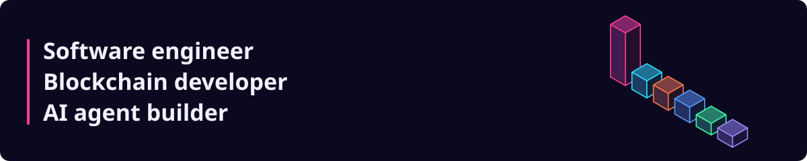

  

  
  
  
  

I take ideas all the way to products people use: high-performance backends, on-chain protocols and the tools AI agents run on.

## Projects

| Project | Stars | What it does |
|---------|-------|--------------|
| **[bunqueue](https://github.com/egeominotti/bunqueue)** |  | Job queue for Bun. Add a job in one language, process it in another. SQLite by default, PostgreSQL when you scale. No Redis. |
| **[binja](https://github.com/egeominotti/binja)** |  | Template engine for Bun with Jinja and Django syntax, plus Handlebars, Liquid and Twig modules. |
| **[flashq](https://github.com/egeominotti/flashq)** |  | Job queue server in Rust with a BullMQ-compatible API. No Redis. |
| **[bunqueue dashboard](https://github.com/egeominotti/bunqueue-dashboard)** |  | Web console to monitor and operate bunqueue from the browser. |
| **[bunpilot](https://github.com/egeominotti/bunpilot)** |  | Process manager for Bun: clustering, crash recovery and zero-downtime reloads. |
| **[agentvm](https://github.com/egeominotti/agentvm)** |  | Coding agents in disposable Debian VMs on your Mac. Apple silicon only. |

## Experience

| Company | Role | Stack |
|---------|------|-------|
| **CRURATED** | Head of Engineering | Elysia/Bun, Solidity, Polygon, Arbitrum, Avalanche, PostgreSQL, Redis, Stripe, OpenTelemetry |
| **Viperblock** (Co-Founder) | Blockchain Developer | Solidity, Hardhat, Node.js, Go, Alchemy, IPFS, Storj, Docker |
| **Funer24** (Freelance) | Full Stack Engineer | Django, Fastify, Go, Vue.js/Nuxt, PostgreSQL, Puppeteer, AWS, Cloudflare |
| **OfCourseMe** | Senior Backend Engineer | PHP/Symfony, Redis, Selenium, MySQL, MongoDB |
| **Asap24** (Freelance) | Backend Engineer | Django, DRF, PostgreSQL, WebSocket, Docker |
| **YOCABE** | Backend Engineer | PHP/Symfony, API Platform, MySQL, Docker |
| **Eveilidia Group** | Software Developer | Django, DRF, Celery, Elasticsearch, PostgreSQL |
| **LUISS ENLABS** | Full Stack Developer | Laravel, jQuery, MySQL |

## Stack

- **Languages:** TypeScript, Rust, Go, Python, Solidity, PHP, Swift
- **Backend:** Bun, Node.js, Elysia, Fastify, Django, Symfony, GraphQL, Prisma
- **Frontend:** React, Vue, Nuxt
- **Data:** PostgreSQL, Redis, SQLite
- **Infrastructure:** Docker, AWS, Cloudflare, Linux, GitHub Actions, OpenTelemetry
- **On-chain:** Ethereum, Arbitrum, Optimism, Polygon, Avalanche, Hardhat, OpenZeppelin, Viem, Wagmi, IPFS
